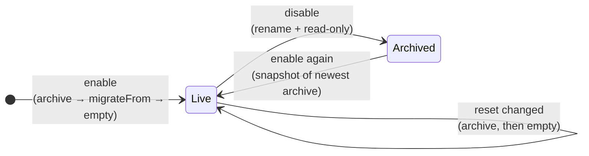
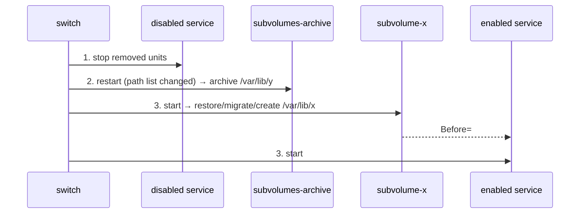
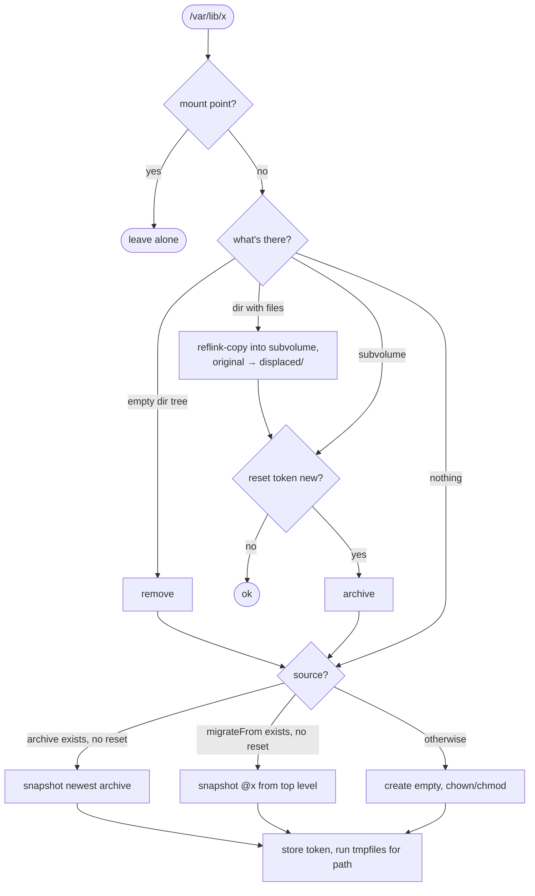

# Service state as btrfs subvolumes
## Layout

```
top level (subvolid=5)
├── @                       → /
│   └── var/lib/
│       ├── paperless/      ← subvolume
│       ├── private/mealie/ ← subvolume
│       └── .subvolumes/
│           ├── managed                     paths declared last run
│           ├── reset/<path>                last reset token
│           ├── archive/<path>/<timestamp>  read-only archives
│           └── displaced/                  converted plain dirs
├── @nix, @persist
└── @paperless, @mealie, …  ← old disko subvolumes, unused, untouched
```

`<path>` = `systemd-escape --path`, e.g. `var-lib-private-mealie`.

## Lifecycle



## Options

```nix
marci.subvolumes.enable = true;            # host
marci.subvolumes.paths."/var/lib/x" = {    # service module
  requiredBy  = [ "x.service" ];           # Requires= + After= on the subvolume unit
  migrateFrom = "@x";                      # used only if no subvolume and no archive
  reset       = null;                      # new value ⇒ start fresh once
  owner = "root"; group = "root"; mode = "0755";  # only for new empty subvolumes
};
```

Postgres, psql-export, tailscale and samba are declared automatically in the module when those services are enabled.

## Generated units

| Unit                         | Runs                     | Does                                                    |
| ---------------------------- | ------------------------ | ------------------------------------------------------- |
| `subvolumes-archive.service` | first                    | archives paths in `managed` that are no longer declared |
| `subvolume-<path>.service`   | after that, one per path | `subvolume ensure …` (flowchart below)                  |

Both are `oneshot`, `DefaultDependencies=no`, `After=local-fs.target`, `Before=sysinit.target`.
At boot they therefore run **before every normal service** and before tmpfiles.
`requiredBy` means a service won't start if its subvolume failed. Restarting the
subvolume unit (e.g. on a reset) restarts the service too.

### On deploy (`switch-to-configuration`)



A disabled service is stopped **before** its data is archived. A new service starts **after** its data exists.

## `ensure` logic



- **Archive** = `mv --no-copy` (atomic rename within `@`) + `btrfs property set ro true`.
- **Restore/migrate** = `btrfs subvolume snapshot` (instant CoW; the source is kept).
- **Subvolume check** = btrfs and inode `256`.
- **Top-level mount** for `migrateFrom` is private to the unit (`PrivateMounts=yes`).

## Reset token

`reset` is compared with `.subvolumes/reset/<path>`. A different, non-null value causes one reset, then the new value is stored.
Keeping the same value, or removing it, does nothing afterwards.

## btrbk

`modules/services/btrbk.nix` now creates every configured `snapshot_dir` via tmpfiles. btrbk used to abort because these directories were missing.
Archives are **local only**. btrbk does not back them up.

## Caveats

- Archives are never pruned automatically.
- If the script's store path changes (nixpkgs bump), the subvolume units restart, and their services restart once.
- Don't declare nested managed paths (`/a` and `/a/b`).
- Renaming a path in Nix = disable old + enable new (old data gets archived).
- Only for hosts with `/var/lib` on btrfs.
